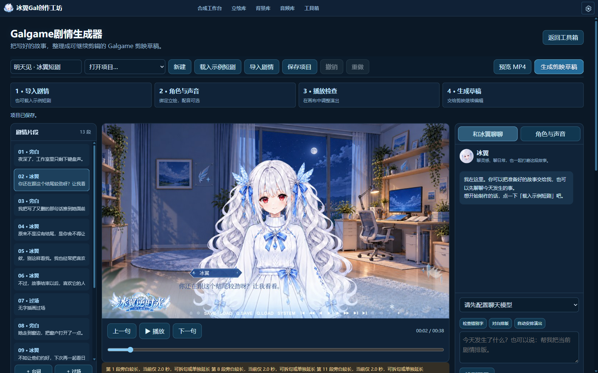
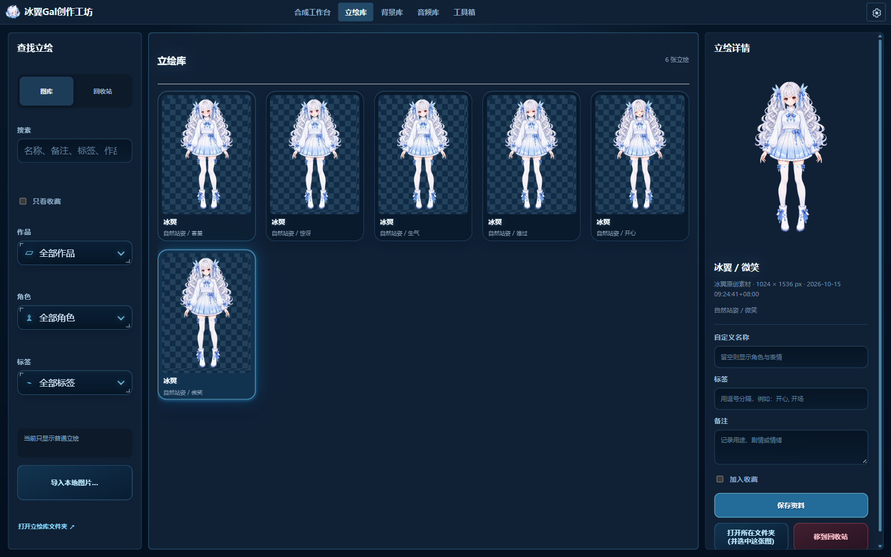
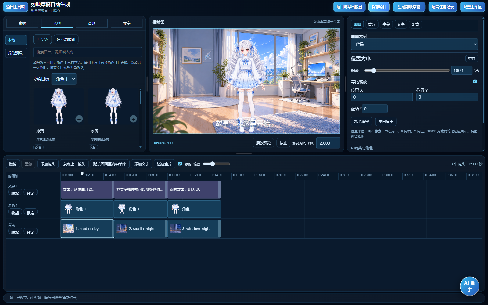

# 冰翼Gal创作工坊

把 Galgame 素材、剧情和配音，整理成可继续编辑的剪映草稿。Windows 本地桌面工具，持续开发中。

- **素材取用**：合成立绘，管理人物、背景和音频，拖入剪辑软件。
- **剧情制作**：编排对白、表情、配音与 BGM，预览演出并生成分轨草稿。
- **草稿修改**：校对已有字幕、调整样式、修复素材引用，保存新草稿或备份后覆盖。
- **按需扩展**：独立接入本地 TTS、语音识别、翻译与聊天模型。

## 界面

剧情与演出预览：



人物与素材管理：



多轨草稿工作台：



截图使用项目内置的原创演示素材。

## 源码运行

Windows 10/11 x64，Python 3.11 以上：

```powershell
py -3 -m venv .venv
.venv\Scripts\python.exe -m pip install -r requirements.txt
.\启动冰翼Gal创作工坊.bat
```

MP4 预览等音视频功能需要 FFmpeg / FFprobe。TTS 运行组件和音色包独立提供；游戏素材与其他模型需自行准备。源码版数据默认保存在 `工作数据`，安装版保存在 `%APPDATA%\BingyiGalCreativeWorkshop`。密钥与工作数据不提交到公开仓库。

使用说明：[剧情](文档/Galgame剧情生成器.md) · [字幕助手](文档/AI字幕助手.md) · [素材与配音](文档/素材配音与人物工作流.md) · [剪映草稿](docs/剪映草稿工作流.md) · [素材包](文档/素材包格式.md)

[开发与打包](DEVELOPMENT.md) · [Apache-2.0](LICENSE) · [第三方声明](THIRD_PARTY_NOTICES.md)
